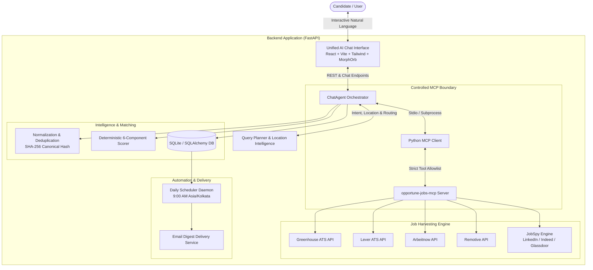

# Opportune AI

> **Autonomous Agentic Job Intelligence & Discovery System powered by Model Context Protocol (MCP)**  
> *Deterministic multi-source job harvesting, query planning, location intelligence, and precision matching.*

---

## 🌟 Overview

**Opportune AI** is an autonomous, agentic job discovery and opportunity intelligence system. Instead of relying on static scrapers or single-board searches, Opportune AI employs a **ReAct-style reasoning agent** (powered by Gemini 2.5 Flash) that dynamically plans queries, routes tasks through **Model Context Protocol (MCP)** tools, queries direct employer ATS systems and job boards concurrently, deduplicates listings, and deterministically ranks matches against candidate profiles.

The application features a single, unified, modern dark-mode AI Chat interface with progressive disclosure, live tool execution audit trails, and interactive match diagnostics.

---

## 🏛️ System Architecture



---

## ✨ Key Features & Capabilities

### 1. 🧠 Agentic AI Query Planner & Location Intelligence
- **Natural Language Understanding**: Understands colloquial, location-specific, and tech-stack queries (e.g., *"Find AI Engineer intern roles in Coimbatore"*, *"Remote Senior Python at GitLab with FastAPI"*).
- **Location Intelligence Engine** (`location_intelligence.py`):
  - Automatically identifies Indian tech hubs (Bengaluru, Chennai, Hyderabad, Coimbatore, Salem, Pune, Gurgaon, etc.) and global tech capitals.
  - Normalizes country codes (e.g. `IN`, `US`, `DE`), detects remote workplace requirements, and routes queries to region-appropriate search connectors.

### 2. 🔌 Controlled Model Context Protocol (MCP) Boundary
Opportune AI encapsulates tool execution behind an audited, schema-validated MCP architecture (`opportune-jobs-mcp`):
- `search_job_sources`: Parallel multi-source dispatch across ATS boards and aggregators with partial-failure isolation.
- `analyze_job_description`: Deep requirement extraction (skills, experience, domain, compensation) with rule-based fallback.
- `calculate_match_score`: Deterministic scoring calculation based on mathematical weighting.
- `get_verified_job_detail`: Safe URL verification with strict **SSRF protection** (blocks private IP ranges, cloud metadata endpoints, and IPv6 NAT64 tunnels).

### 3. 🌐 Broad, Keyless Job Harvesting
- **Direct Employer ATS Connectors**: Queries live public boards of tech leaders via Greenhouse (GitLab, Figma, Stripe, Airbnb, Datadog) and Lever (Palantir, etc.).
- **Verified Tech Aggregators**: Direct API integration with Arbeitnow and Remotive.
- **Multi-Board Aggregation Engine**: Dynamic search across LinkedIn, Indeed, Glassdoor, and ZipRecruiter via JobSpy.

### 4. ⚖️ Deterministic 6-Component Matching Engine
Match scores (0–100) are computed mathematically to eliminate LLM hallucinations:
| Component | Weight | Criteria |
| :--- | :---: | :--- |
| **Skills Match** | **30%** | Overlap between candidate required/preferred skills and extracted JD skills |
| **Title Relevance** | **20%** | Semantic & keyword similarity between target title and role title |
| **Location Compatibility** | **15%** | City/region match, country alignment, or remote compatibility |
| **Experience Fit** | **15%** | Candidate years of experience vs. minimum/maximum requirements |
| **Domain Alignment** | **10%** | Industry/domain match (e.g., FinTech, AI/ML, SaaS, Developer Tools) |
| **Compensation Match** | **10%** | Candidate minimum target vs. posted salary ranges |

- **Score Tiers**:
  - 🟢 **Excellent Fit** (85–100%)
  - 🔵 **Strong Match** (70–84%)
  - 🟡 **Possible Match** (50–69%)
  - 🔴 **Low Match** (<50%)
- **Conservative 5-Signal Deduplication**: Uses normalized title, company, clean location, employment type, and canonical URL hashing to merge identical roles cross-posted across boards.

### 5. 🎨 Sleek, Unified Dark-Mode Frontend
- Built with **React 19**, **TypeScript**, **Vite**, and **Tailwind CSS v4**.
- **MorphOrb Interactive Hero**: Particle-physics AI search bar that transitions through fluid animated states (`idle` ➔ `launch` ➔ `assemble` ➔ `think` ➔ `resolve` ➔ `unfold` ➔ `answered`).
- **Live Tool Execution Audits**: Transparent accordions displaying real-time MCP tool invocations, parameters, latency, and returned record counts.
- **Saved Opportunities Hub**: Persistent bookmarking with search, filter by score tier, and one-click CSV export.
- **Automated Daily Alerts**: Persistent email subscription per conversation for daily digests at 9:00 AM.

---

## 🛡️ Strict Ethical & Security Guardrails

To protect user accounts and maintain ethical compliance:
- ❌ **No automated applications**: Does not submit resumes or fill out ATS forms.
- ❌ **No credential scraping**: Never requests or stores LinkedIn/Indeed user logins.
- ❌ **No cold outreach**: Does not send automated messages or emails to recruiters.
- ✅ **SSRF Protected**: Validates every external URL and IP against IPv4 private subnets and IPv6 translated addresses before requesting content.

---

## 🚀 Quick Start Guide

### Prerequisites
- **Python 3.11+**
- [**uv**](https://docs.astral.sh/uv/) (recommended fast Python package manager)
- **Node.js 20+** & **npm**

### 1. Environment Setup

```bash
# Clone the repository
git clone https://github.com/Niranjan070/Opportune-AI.git
cd Opportune-AI

# Create your local environment file
cp .env.example .env

# Install backend dependencies with uv
uv sync
```

Configure your `.env` file:
```env
GEMINI_API_KEY=your_gemini_api_key_here
DATABASE_URL=sqlite:///./data/opportune.db
PORT=8000
```

### 2. Run Backend Server

```bash
uv run uvicorn backend.app.main:app --reload --port 8000
```
- Interactive Swagger API Docs: `http://localhost:8000/docs`
- Health Check: `http://localhost:8000/api/health`

### 3. Run Frontend Interface

In a separate terminal:
```bash
cd frontend
npm install
npm run dev
```
- Open `http://localhost:5173` in your browser.

---

## 🧪 Testing & Validation

The project maintains a rigorous automated test suite covering units, connectors, MCP tools, query planning, and scoring algorithms:

```bash
# Run all tests
uv run pytest -v

# Run foundation & scoring tests
uv run pytest tests/test_foundation.py tests/test_scorer.py tests/test_location_intelligence.py

# Build frontend production bundle
cd frontend && npm run build
```

---

## 📂 Repository Structure

```
OPPORTUNE AI/
├── backend/
│   ├── app/
│   │   ├── api/             # FastAPI REST routes (chat, jobs, mcp, profiles, health)
│   │   ├── connectors/      # Source connectors (Greenhouse, Lever, Arbeitnow, Remotive, JobSpy)
│   │   ├── mcp/             # opportune-jobs-mcp stdio server implementation
│   │   ├── models/          # SQLAlchemy database models
│   │   ├── schemas/         # Pydantic v2 validation models
│   │   ├── services/        # Agent, QueryPlanner, LocationIntelligence, Scorer, Normalizer
│   │   └── main.py          # FastAPI application entrypoint & startup lifecycle
├── frontend/
│   ├── src/
│   │   ├── components/
│   │   │   ├── chat/        # ChatStream, ChatInput, ChatSidebar, ToolAuditAccordion, EmbeddedJobCard
│   │   │   ├── ui/          # MorphOrb (ai-thiking-orb-and-input.tsx)
│   │   │   ├── JobDetailModal.tsx
│   │   │   └── SavedJobsModal.tsx
│   │   ├── services/api.ts  # API client
│   │   ├── types/index.ts   # TypeScript interfaces
│   │   ├── App.tsx          # Main application orchestrator
│   │   └── index.css        # Midnight theme & MorphOrb keyframes
├── docs/                    # Architecture decisions (ADRs), PRDs, data models, and MCP inventory
├── tests/                   # 80+ automated pytest test suites
├── pyproject.toml           # Python dependencies and metadata
└── README.md
```

---

## 📄 License

Distributed under the MIT License. See `LICENSE` for more information.
