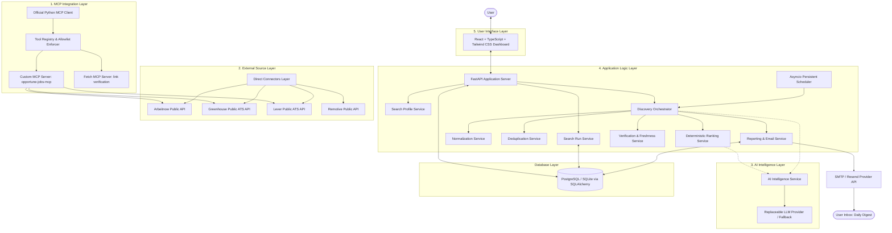

# Opportune AI — System Architecture

**Version:** 1.0.0  
**Pattern:** Modular Monolith with Controlled MCP Boundary  

---

## 1. High-Level Architectural Diagram

---

## 2. The Five Architectural Layers

### Layer 1: MCP Integration Layer
* **Responsibilities:**
  - Implements the Model Context Protocol using the official Python MCP SDK (`mcp>=1.2.0`).
  - Supports standard Transports (stdio / subprocess, in-memory, or SSE).
  - Maintains a validated **Tool Registry** with strict parameter schemas, execution timeouts (15s default), and concurrency bounds.
  - Enforces a tool allowlist: only approved tools (`search_job_sources`, `get_company_postings`, `check_source_status`, `verify_job_url`, `fetch`) can be invoked.
  - Binds diagnostic logging to capture tool latency, payload size, and failure codes.
* **Security Boundary:** MCP servers are treated as untrusted boundaries. No arbitrary environment variables, filesystem writes, or database access are exposed.

### Layer 2: External Source Layer
* **Responsibilities:**
  - Connects to permitted, official, keyless job providers:
    1. **Arbeitnow API:** Broad multi-industry job board search.
    2. **Greenhouse Public ATS API:** Direct employer job boards (Gitlab, Figma, Stripe, Airbnb, etc.).
    3. **Lever Public ATS API:** Direct employer job boards (Palantir, etc.).
    4. **Remotive API:** Global curated remote tech opportunities.
  - Enforces SSRF defense on all outbound HTTP calls.
  - Applies source-specific rate limits and polite User-Agent headers.

### Layer 3: AI Intelligence Layer
* **Responsibilities:**
  - Analyzes unstructured text: parses user-pasted job descriptions into structured requirements.
  - Formulates query criteria (mapping related titles and skills).
  - Generates concise, qualitative match explanations comparing candidate qualifications with listing details.
  - **Graceful Degradation:** If an LLM API key (OpenAI/Gemini/Anthropic) is not provided or the provider experiences an outage, the system automatically falls back to deterministic rule-based extraction and scoring without failing the run.

### Layer 4: Application Logic Layer
* **Responsibilities:**
  - **Normalization:** Converts diverse source payloads into the standardized `NormalizedJob` Pydantic model.
  - **Deduplication:** Conservative 5-signal matching engine that merges duplicate postings across sources while preserving all provenance URLs.
  - **Verification:** Freshness scoring, status calculation (`Recently Checked`, `Likely Active`, `Possibly Stale`, `Unavailable at Source`).
  - **Deterministic Ranking:** Mathematical 6-component weighted scoring formula ($35\%$ skills, $20\%$ title, $15\%$ seniority, $15\%$ location, $10\%$ domain, $5\%$ comp).
  - **Scheduler:** Persistent daily scheduler running at 9:00 AM (configurable).
  - **Reporting & Email:** Generates rich HTML digest reports; enforces strict database idempotency to eliminate duplicate email delivery.

### Layer 5: User Interface Layer
* **Responsibilities:**
  - Fast, responsive React + TypeScript + Vite + Tailwind CSS dashboard.
  - Views: Overview, Ranked Jobs, Job Detail Modal, Search Profiles, JD Analyzer, Run History, Source Health, and Notification Settings.
  - Displays transparent score breakdowns, evidence explanations, and source links.

---

## 3. End-to-End Search Run Data Flow

1. **Trigger:** The daily scheduler fires or the user clicks "Run Search Now" in the dashboard.
2. **Context Assembly:** The Search Run Service creates a unique `SearchRun` entity in the database with status `RUNNING`.
3. **Criteria Compilation:** The user profile and any active target JD are combined into an immutable `SearchSpecification`.
4. **Source Dispatch:** The Discovery Orchestrator activates enabled sources via bounded asynchronous tasks (concurrency limit = 5, timeout = 20s per source).
5. **Collection & Isolation:** Each source connector executes. If a source fails or times out, its error is recorded in `SourceExecutionLog`, and the remaining sources continue uninterrupted.
6. **Normalization:** All raw listings are parsed into `NormalizedJob` models; invalid entries are logged and filtered.
7. **Deduplication:** Cross-source deduplication merges duplicate records and aggregates source URLs.
8. **Ranking & Scoring:** The deterministic scoring engine evaluates each deduplicated job, assigns component scores (0–100), and calculates the final match score.
9. **Explanation Generation:** The AI intelligence layer (or deterministic fallback) generates concise match rationale for top candidates.
10. **Persistence:** The final scored jobs, run summary, and source logs are committed to PostgreSQL inside a database transaction.
11. **Idempotent Email Delivery:** If scheduled, the Email Service checks the idempotency table. If no report was sent for this run, it compiles the HTML digest and dispatches via Resend/SMTP, recording delivery status.
12. **Status Finalization:** The `SearchRun` status updates to `COMPLETED` (or `PARTIAL_SUCCESS` if any source failed).
