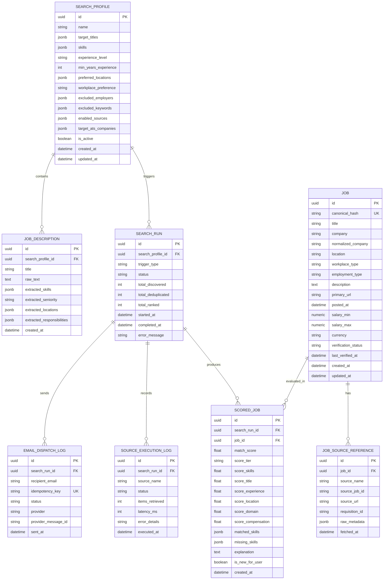

# Opportune AI — Data Model & Schema Specifications

**Version:** 1.0.0  
**Target ORM:** SQLAlchemy 2.0 (PostgreSQL / SQLite)  
**Schema Validation:** Pydantic v2  

---

## 1. Entity Relationship Diagram (ERD)



---

## 2. Core Pydantic Schemas

### 2.1 `NormalizedJob`
```python
class WorkplaceType(str, Enum):
    REMOTE = "remote"
    HYBRID = "hybrid"
    ON_SITE = "on_site"
    UNKNOWN = "unknown"

class EmploymentType(str, Enum):
    FULL_TIME = "full_time"
    PART_TIME = "part_time"
    CONTRACT = "contract"
    INTERNSHIP = "internship"
    TEMPORARY = "temporary"
    UNKNOWN = "unknown"

class VerificationStatus(str, Enum):
    RECENTLY_CHECKED = "recently_checked"
    LIKELY_ACTIVE = "likely_active"
    NEEDS_REVIEW = "needs_review"
    POSSIBLY_STALE = "possibly_stale"
    UNAVAILABLE = "unavailable"

class NormalizedJob(BaseModel):
    source: str
    source_job_id: str
    title: str
    company: str
    location: Optional[str] = None
    workplace_type: WorkplaceType = WorkplaceType.UNKNOWN
    employment_type: EmploymentType = EmploymentType.UNKNOWN
    description: str
    job_url: HttpUrl
    posted_at: Optional[datetime] = None
    salary_min: Optional[float] = None
    salary_max: Optional[float] = None
    currency: Optional[str] = None
    requisition_id: Optional[str] = None
    raw_metadata: Dict[str, Any] = Field(default_factory=dict)
    fetched_at: datetime = Field(default_factory=lambda: datetime.now(timezone.utc))
```

### 2.2 `ScoreBreakdown`
```python
class ScoreTier(str, Enum):
    EXCELLENT = "excellent"    # 85 - 100
    STRONG = "strong"          # 70 - 84
    POSSIBLE = "possible"      # 50 - 69
    LOW = "low"                # < 50

class ScoreBreakdown(BaseModel):
    total_score: float = Field(ge=0.0, le=100.0)
    tier: ScoreTier
    score_skills: float = Field(ge=0.0, le=100.0)
    score_title: float = Field(ge=0.0, le=100.0)
    score_experience: float = Field(ge=0.0, le=100.0)
    score_location: float = Field(ge=0.0, le=100.0)
    score_domain: float = Field(ge=0.0, le=100.0)
    score_compensation: float = Field(ge=0.0, le=100.0)
    matched_skills: List[str] = Field(default_factory=list)
    missing_skills: List[str] = Field(default_factory=list)
    explanation: str
```

---

## 3. Database Indexes & Performance Strategy

1. **`canonical_hash`:** Unique index on `jobs.canonical_hash` for instantaneous duplicate lookups ($O(1)$).
2. **`source_lookup`:** Compound index on `job_source_references(source_name, source_job_id)` for lightning-fast source deduplication.
3. **`run_ranking`:** Compound index on `scored_jobs(search_run_id, match_score DESC)` for ranked pagination.
4. **`idempotency_key`:** Unique index on `email_dispatch_logs.idempotency_key` ensuring zero duplicate emails across scheduler retries.
